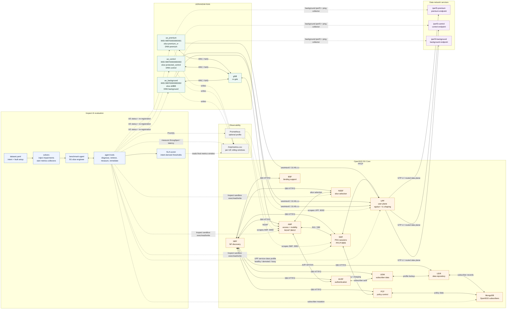

# 5GS Sandbox Architecture

This diagram reflects the active closed-loop benchmark in
`intent_network_slicing/scenarios/three_slice_service_classes`.

## How To Read It

- **Traffic path:** each UE registers through the gNB and AMF, establishes a PDU
  session through SMF and UPF, then sends measured traffic over `uesimtun0` to
  its dedicated iperf3 endpoint.
- **Slice model:** premium, control, and background UEs map to distinct S-NSSAIs
  and DNNs, all riding the same Docker bridge network but measured through the
  5G tunnel path.
- **Closed loop:** Inspect injects a fault, starts background collectors, gives
  the agent diagnostic and remediation tools, and scores the final measurement
  window against the formal intent.
- **Actuation points:** the agent can change AMF, SMF, NSSF, Mongo subscriber
  records, UPF service-class shaping, and UE registration state.
- **Observability:** measurements primarily come from per-UE CSV collectors;
  Prometheus is optional and scrapes Open5GS metrics from AMF, SMF, and UPF.
